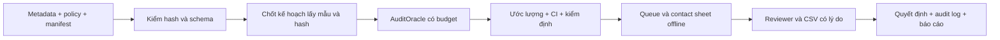

# Group Report — T12 · Vendor Batch Acceptance under Audit Budget

> Toàn bộ kết quả hiện có dùng **nhãn mô phỏng**, không phải nhãn hoặc điểm chính thức của giảng viên.
> Pipeline chạy thành công và review hoàn tất không đồng nghĩa qua quality gate: HOLD rate vẫn vượt 0,4.

## 00 · Thông tin nhóm

| Mục | Giá trị |
|---|---|
| Group ID | Nhóm tự do, khớp `configs/lab.yaml` |
| Challenge | T12 · Vendor Batch Acceptance under Audit Budget |
| Thành viên | Đặng Anh Tuyền (2A202603039): Lead / Integrator + Core algorithm; Nguyễn Chí Tài (2A202603223): QA / metric + Review + Report |
| Git URL | https://github.com/tuyenda2011/K5-Day6-L2-NguyenChiTai-2A202603223-DataGovernanceAndPrivacy |
| Tag demo | `demo-180m` → `eb4d06d21e1a92173bad47de51f393e07b99513e`, đã xác minh từ Git |
| Tag cuối | Xem trạng thái và commit trong [bàn giao Người 2](nguoi2_handover.md) |
| Mốc nộp | README quy định freeze demo phút 180 và hoàn thiện sau 24 giờ; chưa có lịch tuyệt đối từ giảng viên để xác nhận |
| Ngày hoàn thiện phần Người 2 | 15/11/2026, giờ Việt Nam |

## 01 · Bài toán và tiêu chí quyết định

Vendor bàn giao nhãn theo batch. Nhóm cần ước lượng tỉ lệ lỗi với ngân sách kiểm có hạn và ra quyết định ACCEPT / REWORK / HOLD. ACCEPT nhầm batch xấu làm lỗi lan sang huấn luyện/đánh giá; REWORK nhầm gây chi phí sửa; HOLD quá nhiều làm tắc nghiệm thu.

Input là metadata của 5 batch × 100 mẫu và policy; output là `batch_decisions.csv`, mỗi batch đúng một dòng, có ước lượng, số mẫu đã audit, khoảng tin cậy, reason và owner. Nhãn chỉ được lấy qua `AuditOracle`, tối đa 20 mẫu riêng biệt/batch.

Policy đóng băng: batch xấu khi tỉ lệ lỗi > 5%, confidence 95%. Protocol v3 dùng kiểm định một phía: ACCEPT khi `p_accept < 0.025`, REWORK khi `p_rework < 0.025`; còn lại HOLD. Guardrail HOLD ≤ 0,4 là điều kiện đánh giá riêng, không dùng để ép thay đổi quyết định. Domain owner cần xác nhận chi phí sai và mức audit trước khi áp dụng thực tế.

## 02 · Dữ liệu và provenance

| Vai trò dữ liệu | N | Nguồn | License | Phạm vi |
|---|---|---|---|---|
| Input fixture | 500 mẫu, 5 batch | `fixtures/t12_vendor_batches/batches.csv` | CC0-1.0 theo manifest | Metadata tổng hợp; split `na`, không tự tuyên bố có heldout input |
| Dev mô phỏng | Cùng pool, seed 42–61 | `tools/demo_t12.py`, generator v2 | Từ fixture CC0 | Đã dùng khi thiết kế v2/v3 |
| So sánh mô phỏng chính | Cùng pool, 100 lần lặp seed 1000–1099 | `study_protocol_seeds1000-1099.json` | Từ fixture CC0 | Seed mới chốt trước theo metric contract; không phải dữ liệu thực độc lập |
| Đánh giá chính thức | Chưa có nhãn | Overlay `gt/` của giảng viên | Theo gói giảng viên | Chưa chạy, chưa báo điểm |

Schema: `sample_id,batch_id,vendor,risk_tag,annotator_id,seconds_spent,n_boxes`. Nhãn audit mô phỏng có `sample_id,batch_id,is_error`; nhãn batch có `batch_id,true_error_rate,is_bad`. `risk_tag` gồm normal, night, occlusion, small_object. Luồng RNG nhãn riêng với RNG chọn mẫu; pipeline không đọc toàn bộ nhãn để chọn mẫu.

Pipeline kiểm sha256 metadata/policy, không tự thay input. Kết quả kiểm thực chạy ở [verify_manifests.txt](t12_qa/verify_manifests.txt). Không dùng ảnh người thật, model pretrained hoặc API ngoài. Nhãn mô phỏng ở `out/`, không chép vào fixture để giả làm overlay chính thức.

## 03 · Nghiên cứu và thiết kế

Baseline lấy ngẫu nhiên đơn giản không hoàn lại, cùng seed/pool/budget với PoC. PoC phân tầng theo `risk_tag`, mỗi tầng ít nhất một mẫu rồi chia phần còn lại theo kích thước tầng. Ước lượng là tổng `N_h/N × k_h/n_h`, tránh sai trọng số khi các tầng được lấy khác tỉ lệ.

CI dùng nghịch đảo phân phối hypergeometric cho quần thể hữu hạn; PoC ghép CI từng tầng bằng Bonferroni. CI này rộng nên dùng để báo cáo; quyết định v3 dùng kiểm định tại ngưỡng, xét phân bố lỗi bất lợi nhất giữa các tầng. Khi phép liệt kê quá lớn, code quay về CI và ghi `decision_method`. SciPy cung cấp PMF/CDF/SF cho lấy mẫu không hoàn lại; Brown–Cai–DasGupta cảnh báo độ phủ Wald (mục 11).



Trade-off chính là an toàn so với độ trễ nghiệm thu. Ablation chia đều làm tầng lớn thiếu mẫu; kiểm tuần tự [15,20] giảm audit nhưng cần chia alpha theo mốc và báo nguy cơ lệch ước lượng ở thời điểm dừng. Không sửa ngưỡng để cải thiện guardrail.

## 04 · Baseline so với PoC

Nguồn bảng là `reports/t12_simulated/table_baseline_vs_poc.md`, do `src.compare` sinh ở commit `e81b153`, seed 42. Chỉ escape dấu pipe trong đơn vị để Markdown hiển thị đúng; không thay giá trị. Baseline: `src.examples.t12_baseline`; PoC: `src.pipeline` chuyển tới `src/tracks/t12.py`. Cả hai dùng 20 audit/batch, cùng pool và nhãn mô phỏng. QA mới tái lập metric này; runtime/môi trường mới lưu riêng ở `t12_qa/`.

<!-- BEGIN GENERATED baseline -->

Baseline: `simulated_baseline` (git e81b153, seed 42) · PoC: `simulated_poc` (git e81b153, seed 42)

| Metric (unit) | Slice | Baseline | PoC | Δ abs | Δ rel | Better | N |
|---|---|---|---|---|---|---|---|
| **MAE error-rate estimate** (mean \|est - true\| over batches (fraction)) | all | 0.0600 | 0.0421 | -0.0179 | -29.8% | lower | 5 |
| **Bad-batch Recall** (bad batches not ACCEPTed / bad batches (reported separately from MAE)) | all | 1.0000 | 1.0000 | 0.0000 | +0.0% | higher | None |
| False reject rate (good batches sent to REWORK / good batches) | all | 0.0000 | 0.0000 | 0.0000 | baseline=0 | lower | None |
| HOLD rate (batches on HOLD / batches) | all | 0.8000 | 0.8000 | 0.0000 | +0.0% | lower | None |
| CI coverage (batches whose CI contains true rate / batches (nominal 0.95)) | all | 0.8000 | 1.0000 | 0.2000 | +25.0% | higher | 5 |
| Budget violations (batches audited above budget 20) | all | 0.0000 | 0.0000 | 0.0000 | baseline=0 | lower | 5 |
| Guardrail: HOLD rate <= 0.4 (1 = pass, 0 = fail (constrained primary)) | all | 0.0000 | 0.0000 | 0.0000 | baseline=0 | higher | None |
| Runtime / 100 items (s) | all | 0.0477 | 0.0452 | | | lower | |

<!-- END GENERATED baseline -->

Không kết luận sẵn sàng release chỉ từ MAE/recall. HOLD rate vượt guardrail; all-HOLD đạt recall nhưng HOLD tất cả, all-REWORK không HOLD nhưng REWORK nhầm toàn bộ batch tốt. Đối chứng ở `t12_simulated/metrics_all_*.json`.

## 05 · Protocol đánh giá

MAE = `Σ |ước lượng_b − tỉ_lệ_lỗi_thật_b| / số_batch`, đơn vị fraction, thấp tốt. Bad-batch Recall = batch xấu không bị ACCEPT / tổng batch xấu, báo riêng, cao tốt; seed 42 có 3 batch xấu. Batch thiếu trong prediction bị tính ACCEPT. False reject rate = batch tốt bị REWORK / tổng batch tốt; HOLD rate = batch HOLD / tổng batch; CI coverage = tỉ lệ CI chứa tỉ lệ lỗi thật.

Theo [metric_contract.md](metric_contract.md), v2 đổi allocation sau kết quả v1; v3 đổi quyết định sau kết quả v2. Ngưỡng/budget/confidence không đổi. Nhóm công khai thay đổi và dùng 100 seed mới cho so sánh chính; seed 42–61 chỉ là dev. Seed mới không tương đương nhãn giảng viên hoặc dữ liệu thực chưa từng thấy.

Mô phỏng: `python -m tools.demo_t12`. Chỉ khi có overlay mới chạy `python -m tools.submit_t12 --mode official`, sinh metrics và bảng chính thức trong `reports/`. Không dùng `--allow-gt-read`, không chép nhãn mô phỏng vào overlay.

## 06 · Slices, độ bất định và failure cases

Các giá trị sau lấy từ JSON metrics đã commit, tỉ lệ là fraction. Mỗi slice là một batch; không coi 5 batch là 500 quan sát độc lập khi tính metric mức batch.

<!-- BEGIN GENERATED slices -->

| Batch | N input | Tỉ lệ lỗi thật (mô phỏng) | Baseline ước lượng | PoC ước lượng | Baseline / PoC |
|---|---|---|---|---|---|
| V1 | 100 | 0.010000 | 0.000000 | 0.000000 | HOLD / HOLD |
| V2 | 100 | 0.030000 | 0.050000 | 0.000000 | HOLD / HOLD |
| V3 | 100 | 0.080000 | 0.100000 | 0.104000 | HOLD / HOLD |
| V4 | 100 | 0.150000 | 0.150000 | 0.050000 | HOLD / HOLD |
| V5 | 100 | 0.300000 | 0.550000 | 0.346538 | REWORK / REWORK |

<!-- END GENERATED slices -->

Kết quả 100 seed từ `study_summary_seeds1000-1099.csv` (mean ± Monte Carlo SE):

<!-- BEGIN GENERATED study -->

| Phương án | MAE (fraction), mean ± SE | HOLD rate, mean ± SE | CI coverage, mean ± SE | Audit/batch |
|---|---|---|---|---|
| baseline | 0.0477 ± 0.0015 | 0.7540 ± 0.0110 | 0.9880 ± 0.0048 | 20.00 |
| poc | 0.0427 ± 0.0016 | 0.7420 ± 0.0115 | 1.0000 ± 0.0000 | 20.00 |
| balanced | 0.0482 ± 0.0016 | 0.8320 ± 0.0126 | 1.0000 ± 0.0000 | 20.00 |
| sequential | 0.0460 ± 0.0018 | 0.7420 ± 0.0115 | 1.0000 ± 0.0000 | 19.14 |
| all_hold | 0.0477 ± 0.0015 | 1.0000 ± 0.0000 | 0.9880 ± 0.0048 | 20.00 |
| all_rework | 0.0477 ± 0.0015 | 0.0000 ± 0.0000 | 0.9880 ± 0.0048 | 20.00 |

<!-- END GENERATED study -->

PoC giảm MAE trong mô phỏng chính nhưng HOLD chưa giảm rõ; kết quả dev ngược chiều đã ghi ở [t12_report.md](t12_report.md). All-REWORK có false reject rate 1 trong CSV nguồn; không phải cải tiến hợp lệ dù qua guardrail HOLD.

- **Kết luận từ quá ít mẫu:** 0 lỗi/20 không chứng minh đạt 5%. Baseline CI [0;0,15]; CI phân tầng PoC có thể rộng hơn ([0;0,50] ở V1/V2). Nguyên nhân là budget nhỏ và chia mức sai theo tầng; không trộn hai loại CI. Tests: `test_zero_errors_is_not_proof_of_five_percent`, `test_single_audit_cannot_support_a_precise_claim`.
- **Override thiếu căn cứ:** test mới thử note rỗng/chỉ khoảng trắng và ID trùng/lạ; runner trả exit 2, xóa output thành công cũ. Test escalation chuyển REWORK → HOLD, kiểm log append-only, owner/reason và gate.
- **Đổi protocol/replay review cũ:** policy/kế hoạch lấy mẫu được hash trước nhãn; stale review bị từ chối. Khai báo v2/v3, không trình bày như đã chốt từ đầu.
- **Ép ACCEPT khi thiếu bằng chứng:** test có sẵn chặn manual ACCEPT khi `accept_supported=False`. Không loại batch khó vì evaluator coi batch thiếu là ACCEPT.

Latency gốc ở bảng 1 và machine trong JSON nguồn; latency tái lập ở `t12_qa/metrics_*.json`. Đó là một lần đo, không phải benchmark độ trễ ổn định.

## 07 · Review của con người và quyết định

Ngày 15/11/2026 giờ Việt Nam, Nguyễn Chí Tài đã xem thông tin tóm tắt lỗi audit/CI và **xác nhận cả năm quyết định qua hội thoại**. Bài cho phép điền CSV trực tiếp. Không kiểm thêm mẫu.

<!-- BEGIN GENERATED review -->

| Batch | Lỗi thấy / đã audit | CI 95% | Review đã xác nhận | Trước → sau |
|---|---|---|---|---|
| V1 | 0/20 | [0.00; 0.50] | escalate | HOLD → HOLD |
| V2 | 0/20 | [0.00; 0.50] | escalate | HOLD → HOLD |
| V3 | 2/20 | [0.02; 0.58] | escalate | HOLD → HOLD |
| V4 | 1/20 | [0.01; 0.56] | escalate | HOLD → HOLD |
| V5 | 7/20 | [0.07; 0.64] | approve | REWORK → REWORK |

<!-- END GENERATED review -->

CSV, xác nhận, raw/final decisions, log đầy đủ và validator ở [t12_review/README.md](t12_review/README.md). Queue gồm 5 batch, HOLD ưu tiên theo score. Bốn escalation giữ HOLD và cập nhật reason/owner; V5 approve giữ REWORK. Không ép đổi nhãn quyết định để làm đẹp bằng chứng; test riêng đã kiểm REWORK → HOLD.

Validator xác nhận review đầy đủ, đúng 100 audit/5 batch và artifact nhất quán; guardrail vẫn FAIL. Actor review là Nguyễn Chí Tài, owner vận hành mặc định trong config vẫn là Tuyền. Mỗi batch có reason_code và owner.

## 08 · Tái lập và kiểm thử

Python 3.11–3.13 theo README. Phiên bản thực QA được ghi tại [requirements_lock.txt](t12_qa/requirements_lock.txt).

```bash
python -m venv .venv
# Windows PowerShell: .\.venv\Scripts\Activate.ps1
python -m pip install -r requirements.txt
python -m tools.verify_manifests
python -m pytest -q
python -m tools.demo_t12
# Chép reports/t12_review/review_queue_reviewed.csv vào out/t12_demo/poc/.
python -m src.main --config out/t12_demo/config_poc.yaml --output out/t12_demo/poc --pipeline src.pipeline --offline --seed 42
python -m tools.build_t12_report_tables
```

Không tải dữ liệu/model khi chạy pipeline. Review stale phải tạo queue mới và xin review lại, không sửa hash để vượt chặn. Xem [hướng dẫn review](t12_review/README.md) để chạy validator.

<!-- BEGIN GENERATED qa -->

| Kiểm tra | Kết quả thực chạy |
|---|---|
| pytest | 83 passed, 39 skipped, 0 failed, 0 errors |
| Manifest | 14 manifests, 0 failing |
| Python | 3.13.17 |
| OS | Windows-10-10.0.19045-SP0 |
| CPU | Intel64 Family 6 Model 141 Stepping 1, GenuineIntel |
| Source commit QA | `aabff139b35d0ff1d41c9daea0d20df1b23956d9` |

<!-- END GENERATED qa -->

Log đầy đủ ở [test_results.txt](t12_qa/test_results.txt). Các test skip vì không có GT giảng viên; không xem skip là đã kiểm nhãn chính thức. Năm ca mới ở ba hàm test cuối `tests/test_t12_pipeline.py`; đọc queue bằng dtype chuỗi để tránh cảnh báo pandas fillna khác kiểu.

## 09 · Giới hạn và ethics

Nhãn mô phỏng không đại diện vendor thực hoặc thay thế đánh giá độc lập. Recall bằng 1 có thể đi cùng HOLD cao, nên luôn báo guardrail/đối chứng. Nếu scale số mẫu/batch 10× với cùng budget thì tỉ lệ audit giảm, không suy ra độ chính xác giữ nguyên; chi phí kiểm định còn phụ thuộc số tầng và không gian liệt kê.

Fixture CC0 không có PII thực. Ảnh thật cần quyền sử dụng, xử lý PII và giữ ngoài repo công khai. Không tuyên bố đáp ứng GDPR/luật Việt Nam từ PoC. Cải tiến cần chốt protocol trước nhãn mới: tăng budget để chứng minh ACCEPT, khảo sát tầng theo thời gian gán nhãn, đánh giá độc lập và thống nhất chi phí HOLD với domain owner.

## 10 · Đóng góp nhóm

| Học viên | Git author/email | Vai trò và bằng chứng | Commit | Trình bày |
|---|---|---|---|---|
| Đặng Anh Tuyền (2A202603039) | `tuyenda2011` / `tuyenanhdang2011@gmail.com` | Pipeline, baseline, protocol, demo/study/submission, báo cáo kỹ thuật và PDF | `2b5cccd`, `7022eea`, `e81b153`, `697d81f`, `2fb45e4` | Đề xuất phần bài toán, phương pháp, demo; chưa xác nhận lịch thực tế |
| Nguyễn Chí Tài (2A202603223) | `nguyen-chi-tai-2005` / `chitain26@gmail.com` | Test review thành công/lỗi, tái lập QA, review đã xác nhận, báo cáo nhóm và ghi chú slide/debate | `aabff13` và SHA trong `team_contributions.csv` | Chuẩn bị QA, review, failure modes và limitations; buổi trình bày chưa diễn ra |

`team_contributions.csv` là nguồn SHA cụ thể. Không thêm thành viên hư cấu từ template và không ghi đã trình bày khi mới chuẩn bị.

## 11 · Tham khảo

| Nguồn | Ngày đối chiếu | Ý nghĩa |
|---|---|---|
| [Đề T12](../docs/tracks/T12.md), [metric contract](metric_contract.md), `src/metrics/tracks.py::eval_t12` | 15/11/2026 | Contract output, mẫu số metric, batch thiếu và guardrail |
| [SciPy hypergeom](https://docs.scipy.org/doc/scipy/reference/generated/scipy.stats.hypergeom.html) | 15/11/2026 | Phân phối lấy mẫu không hoàn lại; PMF/CDF/SF phục vụ CI/kiểm định |
| [Brown, Cai & DasGupta (2001), Interval Estimation for a Binomial Proportion](https://projecteuclid.org/journals/statistical-science/volume-16/issue-2/Interval-Estimation-for-a-Binomial-Proportion/10.1214/ss/1009213286.pdf) | 15/11/2026 | Hạn chế độ phủ Wald; không coi là chứng minh trực tiếp cho kiểm định phân tầng của nhóm |

## Checklist bàn giao

- [x] Báo cáo đủ 2 thành viên, metric có nguồn script, failure cases và giới hạn.
- [x] Baseline/PoC mô phỏng, provenance, seed và kết quả QA thực chạy.
- [x] Review được người dùng xác nhận, CSV/audit log đã replay, validator PASS.
- [x] Commit test thực chất của Nguyễn Chí Tài.
- [ ] Nhãn/metric chính thức: chờ overlay giảng viên.
- [ ] Guardrail HOLD ≤ 0,4: chưa đạt, đã công bố.
- [x] Đã push nhánh đóng góp `nguyen-chi-tai` lên repo gốc và đối chiếu SHA remote/local.
- [ ] Publish tag cuối và trình bày: xem trạng thái thực tế trong bàn giao.
